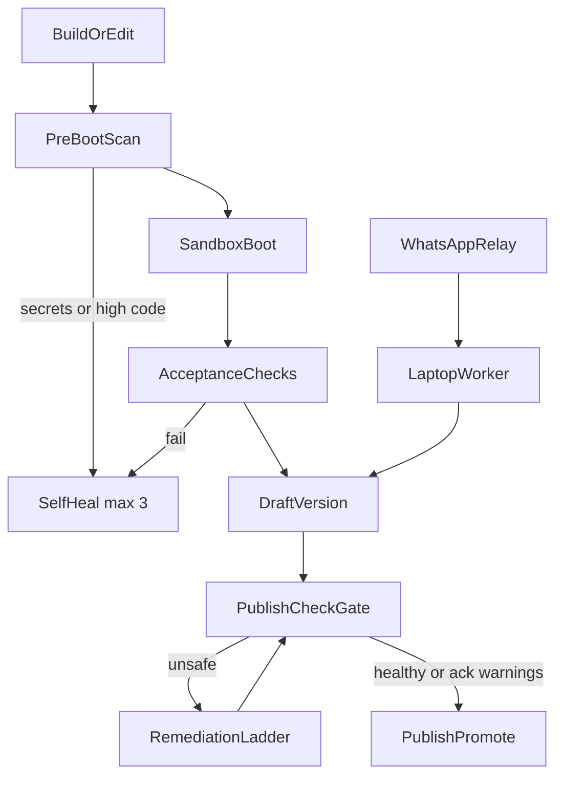

# Terrarium — Architecture

This document is the source of truth for architecture (including Phase 7). Story details live in [`docs/stories.catalog.json`](docs/stories.catalog.json). [`PLAN.md`](PLAN.md) mirrors the phase checklist for historical phases 1–6.

Terrarium is an AI app builder: a user prompt becomes a sandboxed live tool in a parent UI iframe. Agents classify, generate or edit, run in Docker, heal on failure, then stream a preview URL. Phase 7 adds **trust checks**, a **server-side publish gate**, **vulnerability remediation**, and **WhatsApp change requests** via an always-on relay.

## Locked stack

Mixed-language monorepo. The parent UI is TypeScript; orchestration, agents, and the sandbox runner are Python.

**JavaScript (pnpm):**

- `apps/web` — Parent UI (Vite + React + TypeScript + MUI)
- `packages/contracts` — Zod schemas and TS types

**Python (uv workspace):**

- `apps/api` — Orchestration API (FastAPI + Uvicorn)
- `apps/relay` — Always-on WhatsApp/webhook relay (FastAPI; **py-contracts only**)
- `packages/py-contracts` — Pydantic v2 models (camelCase JSON)
- `packages/agents` — Intent, Code Generator, Editor, Self-Healing, Smart Match, acceptance checks
- `packages/sandbox` — Docker runner, Playwright checks, scanners, attack pass

**Shared:** `packages/templates`, `infra/`, `config/remediation-policy.json`, `config/package-alternatives.json`

**Live tool:** always an **iframe** of the sandbox preview URL. Monaco is not the live canvas.

## Phase 7 pipeline

- Agents return `FileMap` only. **Only `packages/sandbox`** starts Playwright, scanner, and attacker containers (pinned image tags).
- Self-heal and remediation: **max 3 attempts**, then escalate visibly.
- Never mutate a **live** version; edits create a **draft**; only `POST /tools/{toolId}/publish` promotes through the gate.

## Frozen contracts (Phase 7 additions)

Implement in `packages/contracts` (Zod) and `packages/py-contracts` (Pydantic). JSON keys are camelCase.

See `packages/contracts/src/index.ts` for full schemas. Summary:

- **Tests:** `AcceptanceCheck`, `AcceptanceCheckResult`; `Intent.acceptanceChecks?`
- **Findings:** `VulnerabilityFinding`, `VulnSource`, `Severity`
- **Health:** `HealthStatus`, `CheckStep`, `ToolHealth`
- **Remediation:** `RemediationStrategy`, `RemediationAttempt`, `Suppression`, `RemediationCampaign`, `LedgerEntry`
- **Change requests:** `ChangeChannel`, `ChangeRequestStatus`, `ChangeRequest`, `ChannelLink`
- **Tool:** optional `autoApproveTests`, `draftVersionId`
- **Publish:** `PublishToolRequest.acknowledgeWarnings?`, `versionId?`

**SessionEventName (new):** `check.started`, `check.step`, `check.completed`, `publish.blocked`, `vuln.detected`, `vuln.remediation.attempt`, `vuln.remediated`, `vuln.suppressed`, `vuln.escalated`, `vuln.campaign.progress`, `change.queued`, `change.claimed`, `change.tests_proposed`, `change.tests_approved`, `change.ready`, `change.published`, `change.failed`

**Payloads:**

- `check.step`: `{ step: CheckStep, status: "running"|"passed"|"failed"|"skipped", detail? }`
- `check.completed`: `{ health: ToolHealth }`
- `publish.blocked`: `{ blockingReasons: string[] }`

## HTTP (Phase 7)

- `POST /sessions/{sessionId}/publish-check` — full gate for the current session FileMap; streams `check.*` on session SSE; returns `ToolHealth`.
- `POST /tools/{toolId}/versions/{versionId}/publish-check` — full gate; streams `check.*` on session SSE or dedicated stream; returns cached `ToolHealth` when `fileMapHash` + `vulnDbVersion` match and age &lt; 24h.
- `POST /tools/{toolId}/publish` — **server gate**; unsafe → `409` + `PublishBlockedResponse`; warning requires `{ acknowledgeWarnings: true }`.
- `GET /tools/{toolId}/health` → `ToolHealthResponse` (live + draft).
- `GET /tools/{toolId}/ledger` → `LedgerResponse`; `?format=csv` export.
- `POST /tools/{toolId}/remediate` — run remediation ladder on blocking findings (owner/editor).
- `POST /settings/whatsapp/link-code` → `WhatsAppLinkCodeResponse`
- `GET /tools/{toolId}/change-requests` — history

**Relay (`apps/relay`):**

- `POST /channels/whatsapp/webhook` — Twilio or Meta adapter; signature required.
- `POST /worker/requests/claim`, `POST /worker/requests/{id}/heartbeat`, `POST /worker/requests/{id}/status`, `GET /worker/requests/{id}/commands` — bearer `WORKER_TOKENS`.

Legacy `POST /sessions/{sessionId}/publish` delegates to the gate when `toolId` is known.

## Package boundaries

| Package | May import | Must not |
| --- | --- | --- |
| `packages/contracts` | — | Docker, LLM, React, FastAPI |
| `packages/py-contracts` | — | Docker, LLM, FastAPI routes, React |
| `packages/agents` | py-contracts, templates | Docker, `apps/*` |
| `packages/sandbox` | py-contracts | LLM SDKs, `apps/web` |
| `apps/api` | py-contracts, agents, sandbox | React UI |
| `apps/web` | `@terrarium/contracts` | Docker, agents, sandbox |
| `apps/relay` | py-contracts | agents, sandbox, Docker, LLM |

## Phase 7 checklist

- [x] [P7-S1](docs/stories/P7-S1-trust-contracts.md) Trust contracts + round-trip
- [x] [P7-S2](docs/stories/P7-S2-acceptance-checks-browser.md) Acceptance checks in browser
- [x] [P7-S3](docs/stories/P7-S3-scanners-preboot-gate.md) Scanners + pre-boot gate
- [x] [P7-S4](docs/stories/P7-S4-live-attack-pass.md) Live attack pass
- [x] [P7-S5](docs/stories/P7-S5-health-publish-gate.md) Health + publish gate
- [x] [P7-S6](docs/stories/P7-S6-trust-card-ui.md) Trust Card UI
- [x] [P7-S7](docs/stories/P7-S7-remediation-ladder.md) Remediation ladder + ledger
- [x] [P7-S8](docs/stories/P7-S8-whatsapp-relay.md) WhatsApp relay
- [x] [P7-S9](docs/stories/P7-S9-change-request-worker.md) Change-request worker
- [x] [P7-S10](docs/stories/P7-S10-fleet-campaigns-digest.md) Fleet campaigns + digest

## Hard rules (every story)

Same as PLAN.md: dual contracts, sandbox-only Docker, max 3 heal/remediation, iframe preview, Smart Match never auto-accepts, change only listed packages.
