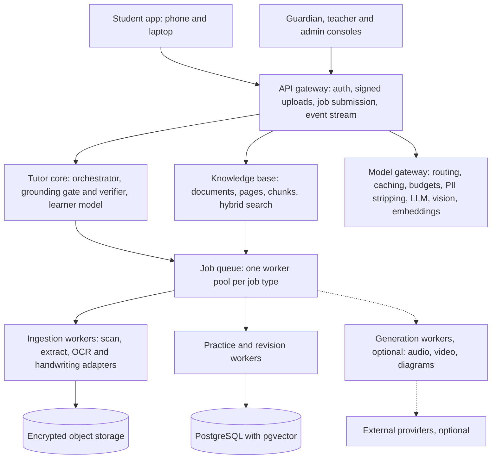
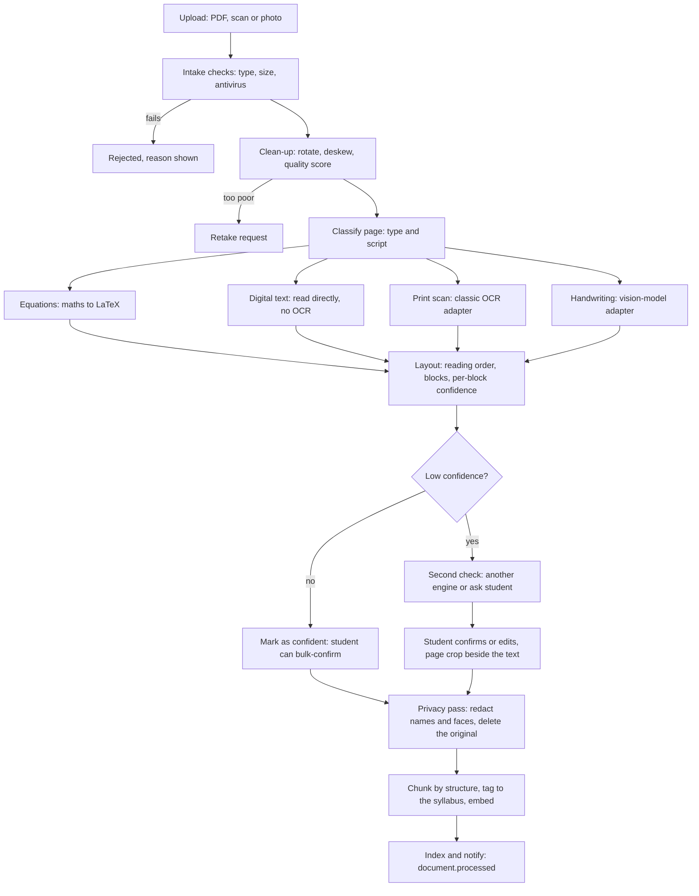
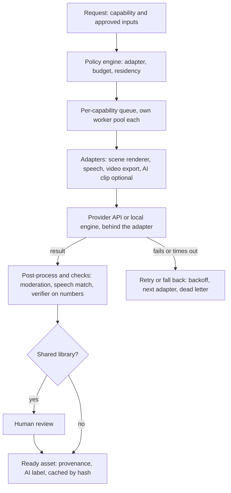
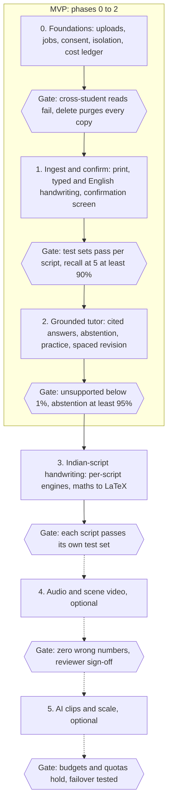

# Modular AI Learning Platform: Tutor, Personal Knowledge Base and Optional Generation Services

As of 2026-10-11. Save as `docs/KNOWLEDGE_PLATFORM.md`.

Implementation note: this is a design. The repository may already contain parts of it (grounded Ask and passages, the model gateway, jobs, consent scopes, FSRS cards, orchestrator, verifier). Implementation must start with an audit and reuse existing components wherever possible instead of building a parallel stack.

---

## 1. Summary and key design decisions

Build a small tutoring core that treats every upload as untrusted, versioned, source-tagged data, and attach video, audio and quiz generation as optional workers behind one provider-neutral job interface. The tutor must work fully with every generator switched off.

| Decision | Why |
| --- | --- |
| Two knowledge stores that are never silently mixed: **Curated** (approved, licensed) and **Personal** (student uploads) | A student's notes can contain mistakes or copyrighted pages; answers must always say which tier they came from |
| Uploads become pages, blocks and chunks with confidence scores, and the student confirms low-confidence text before it is trusted | Handwriting and scans are the main source of silent errors |
| The tutor core stays deterministic where it matters: what to teach next, whether an answer is correct, when to reveal. Retrieval and the LLM only find and phrase | Keeps accuracy testable and prevents invented content |
| Every heavy task is an asynchronous job: ingestion, embedding, video, audio, quiz generation | The API stays fast; each worker pool scales and fails independently |
| Generation uses capability-based adapters, not provider SDKs in core code | Replacing a video engine is a new adapter plus configuration, not a core change |
| Start as a modular monolith with separate worker processes; split into services only when a measured bottleneck demands it | Lowest cost and complexity for an MVP |
| Private by default: encrypted storage, per-student isolation, originals deleted after extraction unless the student keeps them, no sharing between students | Students are minors, and notebook photos often carry names and faces |
| Cheapest capable method first: embedded PDF text, then classic OCR, then a vision model only for hard pages | Most pages do not need an expensive model |

Essential features are listed in the scope section. Everything in the generation platform is optional and can be enabled per deployment, per student or per plan.

---

## 2. Scope: essential, later, out of scope

The MVP is upload, then clean confirmed text, then grounded answers, practice and spaced revision. Every generation feature comes later and stays optional.

| Area | Essential (MVP) | Later (optional modules) | Out of scope |
| --- | --- | --- | --- |
| Ingestion | PDF with text layer, scanned PDF, photos, handwritten pages in English; page-quality check; student confirms low-confidence text; delete originals after extraction | Handwriting in Indic scripts (after per-language measurement), maths-to-LaTeX, diagram understanding, batch folder import | Ingesting copyrighted publisher books for other users |
| Knowledge base | Pages, blocks, chunks, embeddings; hybrid search scoped to one student; citations to page and image crop; curated store kept separate from personal store | Concept graph, deduplication across uploads, shared class libraries with teacher approval | Open-web search or any web fallback |
| Tutor | Source-grounded Q&A and explanations; refuses and says so when sources do not support an answer; the existing deterministic orchestrator for practice | Voice Q&A, multi-turn study plans from uploaded syllabus | General-purpose open chat |
| Practice and revision | Questions generated from sources with machine-verified answers where possible; spaced revision (FSRS) over concepts and cards; basic quizzes | Exam-pattern mock tests from uploaded papers, adaptive difficulty from uploads | Auto-grading of long free-text answers by an LLM alone |
| Generation | Device read-aloud (no server cost) | Server audio explanations in Indic voices; deterministic whiteboard-style video lessons rendered from approved scene scripts; external AI video engines through adapters for illustrative clips | Maths or text rendered inside AI-generated video |
| Accounts and privacy | Guardian consent, per-student isolation, encryption, export and delete, audit log | Teacher sharing, school tenants, SSO | Student-to-student sharing, ads, tracking SDKs, biometrics |
| Operations | Job queue, retries, dead-letter queue, cost ledger, basic evals | Autoscaling pools per job type, provider failover, A/B testing of providers | Multi-region active-active at launch |

---

## 3. Architecture overview

Read it top to bottom: requests enter through the gateway, the tutor core and knowledge base answer from stored data, and anything slow becomes a queued job handled by its own worker pool. Dashed parts are optional.



Only adapters reach outside providers; the tutor core runs without them.

---

## 4. Core components and their boundaries

Package the logical modules as one deployable codebase with separate worker processes. Modules talk only through typed interfaces and events (for example `document.processed`, `job.completed`); no module reads another module's tables.

| Component | Responsibility | Scales by |
| --- | --- | --- |
| API gateway | Authentication, upload URLs, job submission, job progress over server-sent events, rate limits | Stateless replicas |
| Identity, consent and policy | Accounts, guardian consent scopes, feature flags per student or plan, quotas | Small database |
| Storage service | Encrypted object storage for originals and derivatives, signed URLs, retention rules | Object store |
| Ingestion workers | Virus scan, file typing, page splitting, text extraction, OCR and handwriting recognition through adapters, layout, quality scoring | CPU or GPU worker pool |
| Review and correction | Shows extracted text beside the page image, stores student corrections, feeds quality metrics | API plus database |
| Knowledge base service | Documents, pages, blocks, chunks, embeddings, trust tiers, hybrid retrieval scoped to one student, citations | Database and vector index |
| Tutor core | Deterministic orchestrator, grounding gate, verifier (maths and fact checks), learner model (mastery, spaced revision), prompt assembly | Stateless replicas |
| Model gateway | One interface to LLM, vision and embedding providers: routing, caching, budgets, PII stripping, call logging | Stateless replicas |
| Practice and revision | Question generation jobs, answer verification, card scheduling, quiz assembly | Worker pool |
| Generation platform | Job orchestrator, provider adapter registry, render and audio workers, moderation and review gate, asset store | Separate pools per job type |
| Observability and cost | Logs, traces, per-student and per-provider cost ledger, evaluation runs | Managed services |
| Admin and review console | Content review queue, provider configuration, incident tools | Web app |

Three rules keep it modular. The tutor core never imports a provider SDK. Every long task is a job with an id, a status and a result reference. Every feature that costs money is behind a flag, a quota and a ledger entry.

---

## 5. Ingestion and processing pipeline

Route every page to the cheapest method that meets a quality threshold, and never trust the output until the student has confirmed anything below the confidence line.



| Stage | What happens | Output |
| --- | --- | --- |
| 1. Intake | Size and type limits, antivirus scan, file-type check by content (not extension), strip location metadata, store the original encrypted | Document record, original asset |
| 2. Page split and clean-up | Split PDFs into pages; for photos fix rotation, perspective and lighting; score blur and glare; ask for a re-photo when too poor | Page images, quality score |
| 3. Classify | Digital text, scanned print, handwriting, mixed, diagram, table or equation-heavy; detect language and script | Page type, script |
| 4. Extract | Digital text is read directly with no OCR; scanned print uses a classic OCR adapter; handwriting, mixed pages and poor scans use a vision-model adapter; equations go to a maths recogniser that outputs LaTeX; diagrams are kept as image crops with a caption | Text blocks with boxes |
| 5. Layout | Reading order, headings, lists, tables, figures, each block tied to its box on the page | Structured blocks |
| 6. Confidence and repair | Per-block confidence; low scores trigger a second engine or a question to the student; a language model may correct flagged spans only, and every correction is logged | Repaired blocks |
| 7. Student confirmation | The student sees the crop beside the text and fixes errors; confirmed blocks are marked trusted | Trusted text |
| 8. Privacy pass | Detect names, phone numbers and faces; redact them in derived text and crops; delete the original unless the student chooses to keep it | Redacted derivatives |
| 9. Chunk and enrich | Chunk by structure, tag to the syllabus tree, extract key terms and definitions, create embeddings | Chunks, vectors, tags |
| 10. Index and notify | Write to the knowledge base and emit `document.processed` | Searchable document |

**Why confirmation is not optional.** Handwriting results vary a great deal between engines and test sets. A January 2026 controlled cursive test placed vision-language models such as GPT-5, Gemini 3 Pro Preview and olmOCR-2-7B ahead of dedicated OCR APIs on semantic similarity, and the same guide reports Azure Document Intelligence dropping to about 45% on cursive narrative text ([source](https://imagetotable.ai/blog/the-ultimate-guide-to-ai-handwriting-to-text-conversion)). Vendor claims of 99% accuracy are not comparable across sources.

**Indian scripts need their own measurement.** A June 2026 Devanagari benchmark found that strong English OCR does not predict Indic OCR: on 300 real printed scans nine of ten systems collapsed, Gemini and Claude led at chrF++ 86.3 and 82.2, and the open Qwen3-VL-8B scored 75.2 while running on a single 24 GB GPU ([source](https://arxiv.org/pdf/2606.29213)). For other Indian languages, Sarvam published an Indic OCR benchmark of 6,909 samples across 22 languages that can seed your own test set ([source](https://www.sarvam.ai/blogs/sarvam-vision-2-1)). Treat each script and each engine as unproven until it passes your own sample set (see the accuracy section).

**Fast path target.** A digital PDF page should be searchable within seconds, because it needs no OCR. Handwritten pages are slower and costlier, so show progress and let the student start asking questions about already-processed pages.

---

## 6. Knowledge base and retrieval

Store everything the tutor may use as a chunk with a trust tier, a source pointer and a scope, and retrieve only inside the asking student's scope.

| Tier | Source | May be used for | Shown to the student as |
| --- | --- | --- | --- |
| T1 Curated | Teacher-written or licensed content that reviewers approved | Explanations and answers of record | "From the syllabus content" |
| T2 Verified | Results computed by code: algebra, calculus, units, balanced equations | Every numeric or symbolic answer | "Checked by calculation" |
| T3 Personal, confirmed | The student's own uploads after they confirmed the text | Explanations in their own wording, practice questions, revision cards | "From your notes, page 12" |
| T4 Personal, unconfirmed | Low-confidence extracted text | Shown to the student for correction only | "Please check this text" |
| Never | Open web, other students' uploads, unlicensed publisher content | Nothing | Not available |

When a personal note disagrees with T1 or T2, the tutor says so gently ("check this line: 2x = 8 gives x = 4") and never silently changes the note or silently trusts it.

**Chunking.** Chunk by structure, not by fixed length: a definition, a worked example, a theorem with its conditions, a table, or an equation with its explanation each stay whole. Aim for roughly 200 to 500 tokens as a starting range, then tune on retrieval tests. Every chunk keeps its document, page and bounding boxes so the answer can show the original crop.

**Retrieval.**

1. Filter first: student id, subject, syllabus node, tier, language.
2. Search with keywords (BM25) and embeddings together, then rerank the top 20 to 50.
3. Use an English canonical term list so a Hindi, Bengali or Assamese question can find English notes and the reverse.
4. Apply a relevance gate: strong match, answer; ambiguous, ask which topic the student means; weak, say it is not in their materials, offer the curated content or a teacher, and log a content gap. No web fallback.

**Citations are checked, not decorative.** The tutor must name the chunk ids it used. A validator removes any sentence that has no supporting chunk and falls back to showing the source text itself.

**Versioning.** Re-processing a document creates a new version. Student corrections are stored as separate edits and re-applied, so an upgrade to the OCR engine never erases a confirmed fix.

---

## 7. How the tutor uses the knowledge base

The tutor core decides what to do next; the knowledge base only supplies and checks material. The same orchestrator, verifier, hint ladder and mastery rules that govern curated content govern personal content.

| Capability | How it works | Guardrail |
| --- | --- | --- |
| Grounded explanation | The orchestrator picks the topic and the move (question, hint, example, explanation). Retrieval returns T1 and T3 chunks. The model phrases them at the student's level using only those chunks and the term list, and the answer carries source chips | Unsupported sentences are removed; no source means the tutor says so |
| Explain my notes | The student selects a page region; the tutor explains it step by step and runs the verifier on every equation or calculation | Errors are flagged as "check this line", never silently fixed |
| Practice from uploads | Numeric and symbolic questions are built from templates and confirmed worked examples, with answers and steps verified by code. Multiple-choice and short-answer questions are drafted by a model from one chunk, with the supporting sentence attached | Each draft must pass an "answerable from the chunk" check and a one-correct-answer check; items are labelled "made from your notes" |
| Revision | Definitions, formulas and worked examples become cards; spaced scheduling (FSRS) decides what to review; sessions start with due cards | Mastery changes only from items with machine-verified answers |
| Quizzes | Assembled from verified and confirmed items, with optional timing | A quiz never includes unverified items in a scored section |
| Weak-spot finder | Wrong answers map back to the chunks and pages they came from | Shown as "revisit page 12", not as a score |
| Study plan (later) | Combines the syllabus tree, upload coverage and the exam date | Shown as topics to focus on, never a predicted mark |

**What personal content must not do.** It never enters the curated pools, never feeds shared analytics, and never changes another student's experience. Items without a verifiable answer become self-check cards: the student compares with the note, and nothing updates mastery.

**Answer policy for student questions.** If the question is about the item the student is practising now, route it to the hint ladder, not to a direct answer. If it is about their notes or the syllabus, answer from sources. If it is out of scope, say so plainly.

---

## 8. Optional generation platform: adapters and asynchronous jobs

Treat every generator as a capability behind an adapter. The core asks for a capability such as `narration_audio` or `scene_video`, the platform picks an adapter by policy, runs it as a job, and returns an asset with provenance. Nothing in the tutor depends on any generator being installed.

**Why adapters are not optional.** The video market changes within months: OpenAI discontinued Sora as an app on 26 April 2026 and marked its API for shutdown on 24 September 2026, and Google replaced the Veo 3 API with Veo 3.1 on 30 June 2026 ([source](https://provimedia.de/en/blog/ai-video-tools-2026)). A provider-specific call buried in core code would have broken twice this year.

| Capability | Input | Output | Default adapter (no external cost) | Optional adapters |
| --- | --- | --- | --- | --- |
| `narration_audio` | Approved script, language, voice | Audio plus word timings | Device read-aloud | Server speech engines for Indian languages; the open Indic Parler-TTS lists Assamese, Bengali, Nepali and 18 more ([source](https://huggingface.co/ai4bharat/indic-parler-tts/blame/c302b0073a987e92c7c558600c16c408031ad580/README.md)) |
| `scene_video` | Scene script (approved text, verified numbers) | Player package or MP4 | In-app scene player drawn on the device | MP4 rendering with Manim (open source, check its licence) or Remotion, free for individuals and companies of up to three people ([source](https://companies.remotion.dev/license)) |
| `ai_video_clip` | Visual prompt with no text or maths | 4 to 15 second clip | None | Veo, Kling, Runway, Seedance or an aggregator; first-party prices ranged from about $0.03 to $0.70 per generated second in 2026 ([source](https://www.cometapi.com/ai-video-api-pricing/)) |
| `quiz_items` | Chunks and objectives | Verified items | Internal generator plus verifier | Any language-model adapter |
| `diagram` | Structured spec | SVG | Deterministic renderer | Image-model adapter |

**Adapter contract.** Every adapter implements the same small interface, so adding or replacing one touches only its own package and a configuration row.

```text
GenerationAdapter
  id, version, capabilities[]
  describe()   -> languages, max_duration, cost_model, limits, data_residency, moderation
  estimate(request)                    -> cost, eta
  submit(request, idempotency_key)     -> provider_job_ref
  poll(provider_job_ref) | handle_webhook(payload) -> status, progress
  fetch(provider_job_ref)              -> ArtifactDescriptor[]
  cancel(provider_job_ref)
  healthcheck()
```

**Job lifecycle.** `queued`, `validating`, `submitted`, `postprocessing`, `moderation`, `review` (only when required), then `ready`, `failed` or `cancelled`. Use idempotency keys, retries with backoff, per-adapter timeouts, a dead-letter queue, webhooks with polling as a fallback, and progress events to the client over server-sent events.



The policy engine, not the tutor, chooses the adapter. If it fails, the job retries and then falls back to the next adapter or the dead-letter queue; the tutor only ever sees a job status.

**Policy engine.** For each request it picks an adapter by capability, language, budget, data-residency rule and health, with a fallback chain and a kill switch per adapter. Results are cached by a hash of script, voice and settings, so identical content is never paid for twice.

**Accuracy rules for generated media.**

- Inputs come from T1 and T3 chunks and approved scripts, never from raw student free text.
- Maths, formulas, labels and any text on screen are drawn by the deterministic renderer, never inside AI-generated video. Generated clips are for illustrations and analogies only.
- Every asset stores its provenance: input chunk ids, adapter and version, prompt hash, cost and moderation result.
- Automated checks run before delivery: moderation, a speech-to-text check that the narration matches the script, and a verifier pass on every number. Assets for a shared library also need human review; assets for one student's private use may skip it but keep an "AI-generated" label.

**Independent scaling.** Each capability has its own queue and worker pool, with an optional GPU pool for self-hosted speech or OCR models. Switching a capability off removes its queue and its menu entry without touching anything else.

---

## 9. Data models

Every student-owned row carries `student_id` so row-level security can isolate students in the database itself. Use time-ordered UUIDs, soft delete followed by a purge job, JSONB only for adapter-specific parameters, and a vector column on chunks.

**Identity and policy**

| Entity | Key fields |
| --- | --- |
| `accounts` | id, role (guardian, teacher, admin), contact, locale |
| `students` | id, guardian_id (null for guests), display_name (optional), grade, curriculum_id, home_locale, medium_locale, mode (guest, family, school) |
| `consents` | id, student_id, guardian_id, scopes[], version, granted_at, revoked_at |
| `entitlements` | student_id or plan_id, feature, enabled, monthly quota |

**Knowledge base**

| Entity | Key fields |
| --- | --- |
| `documents` | id, student_id, title, source_type (pdf, photo, scan), status, keep_original, retention_days, current_version_id |
| `document_versions` | id, document_id, pipeline_version, adapters_used, status, quality_score |
| `assets` | id, owner, kind (original, page_image, crop, audio, video), storage_key, sha256, bytes, mime, key_ref, expires_at |
| `pages` | id, version_id, page_no, page_type, script, quality_score, image_asset_id |
| `blocks` | id, page_id, kind (text, handwriting, equation, table, figure), bbox, text, latex, confidence, status (extracted, confirmed, edited, rejected), engine, engine_version |
| `block_edits` | id, block_id, student_id, old_text, new_text, created_at |
| `chunks` | id, version_id, student_id, tier (T1 to T4), text, block_ids[], page_refs, syllabus_node_id, language, content_hash, embedding |
| `terms` | term, language, translation, syllabus_node_id |
| `syllabus_nodes` | id, curriculum_id, parent_id, title, weight (reused from the curriculum registry) |

**Tutor, practice and revision** (extends the existing engine)

| Entity | Key fields |
| --- | --- |
| `items` | id, source_tier, source_chunk_id, role, type, stem, answer, solution_steps, status (draft, checked, approved), verification result |
| `cards` | id, student_id, source_chunk_id, kind (definition, formula, example, question), front, back, verified |
| `review_cards`, `mastery`, `sessions`, `events` | Unchanged from the current tutor engine |
| `grounding_logs` | id, session_id, question_hash, chunk_ids[], gate_outcome (answer, clarify, abstain), sentences_removed |

**Generation platform**

| Entity | Key fields |
| --- | --- |
| `generation_requests` | id, student_id, capability, input_ref (chunk ids or script id), params, policy_decision, status |
| `jobs` | id, request_id, adapter_id, adapter_version, provider_job_ref, state, attempts, error_code, cost_estimate, cost_actual, idempotency_key |
| `generated_assets` | id, job_id, asset_id, capability, language, duration_ms, provenance, moderation, review_status, ai_label, cache_key |
| `scripts` | id, source_chunk_ids, scene_json or narration text, status, reviewer, approved_at |
| `adapter_configs` | id, adapter_id, capability, enabled, priority, non-secret params, secret_ref, residency, rate_limit, budget_cap |
| `usage_ledger` | id, student_id, provider, capability, units, cost, job_id, created_at |
| `audit_events` | id, actor, action, subject, created_at (no raw content) |

---

## 10. APIs

Use versioned REST with an OpenAPI contract. Long work follows one pattern everywhere: the call returns `202` with a job id, progress arrives over server-sent events, and the result is fetched by reference. Every mutating call accepts an idempotency key.

| Group | Endpoint | Purpose |
| --- | --- | --- |
| Uploads | `POST /v1/uploads` | Get a signed URL for direct upload to storage, with size and type limits |
| Documents | `POST /v1/documents` | Create a document from uploads; returns document id and job id |
| | `GET /v1/documents`, `GET /v1/documents/{id}` | List and inspect, including processing status |
| | `GET /v1/documents/{id}/pages/{n}` | Page image (signed, short-lived) with blocks and confidence |
| | `PATCH /v1/blocks/{id}` | Edit, confirm or reject extracted text |
| | `POST /v1/documents/{id}/confirm` | Confirm all high-confidence blocks at once |
| | `POST /v1/documents/{id}/reprocess` | Re-run with a newer pipeline; edits are re-applied |
| | `DELETE /v1/documents/{id}` | Purge originals, derivatives, chunks and vectors |
| Tutor | `POST /v1/tutor/sessions`, `POST /v1/tutor/sessions/{id}/events` | The existing event API (answer, request help, continue) |
| | `POST /v1/tutor/ask` | Grounded question about a page region, a document or the syllabus; returns answer, clarify or out-of-scope, plus sources |
| | `GET /v1/sources/{chunk_id}` | Citation view: page crop and text |
| | `POST /v1/search` | Scoped search for the library screen |
| Practice and revision | `POST /v1/practice/generate` | Create practice items from a document or chunks (job) |
| | `GET /v1/revision/due`, `POST /v1/revision/{card_id}/review` | Spaced revision queue and rating |
| | `POST /v1/quizzes`, `POST /v1/quizzes/{id}/submit` | Assemble and submit a quiz |
| Generation | `GET /v1/generation/capabilities` | What is enabled for this student and plan |
| | `POST /v1/generation/requests` | Request audio, scene video, AI clip or diagram; returns estimate and job id |
| | `GET /v1/generation/requests/{id}`, `DELETE ...` | Status and cancel |
| | `GET /v1/jobs/{id}`, `GET /v1/jobs/{id}/events` | Job state and event stream |
| | `GET /v1/assets/{id}`, `POST /v1/assets/{id}/report` | Signed download and "this looks wrong" report |
| Privacy | `POST /v1/consents`, `GET /v1/me/export`, `DELETE /v1/me` | Consent, export and deletion |
| Admin (internal) | `/admin/adapters`, `/admin/jobs`, `/admin/review-queue`, `/admin/usage`, `/admin/evals` | Provider configuration, retry and dead-letter handling, content review, cost and evaluation dashboards |

**Example: request a narrated lesson.**

```text
POST /v1/generation/requests
{ "capability": "scene_video",
  "input_ref": { "chunk_ids": ["c_91", "c_92"] },
  "params": { "language": "en", "audio": true, "max_seconds": 90 } }

202 { "request_id": "r_71", "job_id": "j_88",
      "estimate": { "cost_usd": 0.02, "eta_s": 40 } }

GET /v1/jobs/j_88/events   (server-sent events: validating, rendering 60%, ready)
GET /v1/assets/a_55        (signed URL, ai_label: true, sources: [c_91, c_92])
```

**Internal contract.** Adapters never receive a student's identity. They receive a request id, approved inputs and parameters, and they return artefacts. Webhooks from providers land on one signed endpoint and are translated into job events.

---

## 11. Technology stack

Keep the stack you already run (Python, FastAPI, Postgres with pgvector, Redis, Next.js) and put every swappable component behind an adapter. Licences and prices below must be re-checked before commitment; several vendors changed terms this year.

| Layer | MVP choice | Swap-in alternatives | Notes |
| --- | --- | --- | --- |
| Backend | Python 3.12, FastAPI, Pydantic v2, SQLAlchemy 2, Alembic | Any framework that can serve OpenAPI | Same as the current engine |
| Database | PostgreSQL 16 with pgvector and row-level security | A dedicated vector database such as Qdrant if vector load outgrows Postgres | One store for relational and vector data keeps the MVP simple |
| Jobs | Redis with RQ plus a `jobs` state table | Celery; Temporal if workflows with human review steps and long provider polling become complex | Move to Temporal only when a measured need appears |
| Object storage | S3-compatible with server-side encryption and lifecycle rules (MinIO in development) | Any cloud object store | Signed URLs only; no public buckets |
| PDF text and images | A permissively licensed PDF library (verify licences; some popular ones are AGPL), OpenCV and Pillow for clean-up | Cloud document APIs | Digital PDFs need no OCR |
| Print OCR adapter | Open-source engine such as Surya or PaddleOCR, self-hosted | Azure Document Intelligence, Google Document AI, AWS Textract | Pick per script after measuring |
| Handwriting and hard pages | A vision-language model through the model gateway | Self-hosted open model (Qwen3-VL-8B ran on one 24 GB GPU in the Devanagari benchmark); Sarvam Vision for Indian languages ([source](https://www.sarvam.ai/blogs/sarvam-vision-2-1)) | Routing table by script, language and quality score |
| Maths recognition | Vision-language model prompted for LaTeX, then SymPy parse check | Dedicated maths OCR | Reject LaTeX that does not parse |
| Embeddings and reranking | A multilingual embedding model behind the gateway; Postgres full-text plus vectors; a small reranker | Hosted rerank APIs | Test on your own Hindi, Bengali, Assamese and Nepali queries before trusting it |
| Model gateway | LiteLLM (already in use) or a thin in-house layer | Provider-native SDKs inside adapters only | Routing, caching, budgets, PII stripping, logging |
| Verification | SymPy (existing), a units library for physics, a custom equation balancer for chemistry | Computer-algebra services | Machine proof before any claim of correctness |
| Speech | Device read-aloud by default | Server voices: Sarvam Bulbul covers 11 Indian languages but not Assamese or Nepali ([source](https://www.sarvam.ai/apis/text-to-speech.md)); open Indic Parler-TTS covers both; ElevenLabs and Google as fallbacks | A July 2026 comparison rated Bulbul best on the languages it tested, ElevenLabs a strong second and Google reliable but not best on Indic ([source](https://caller.digital/blog/indic-tts-benchmark-bulbul-elevenlabs-sarvam-google-ai4bharat-2026)) |
| Scene video | In-house SVG and JavaScript scene player | Manim or Remotion plus ffmpeg for MP4 export | Remotion needs a paid company licence for teams of four or more |
| AI video clips | None by default | Veo, Kling, Runway, Seedance, or an aggregator exposing many models through one key ([source](https://techsy.io/en/blog/best-ai-video-providers)) | Optional adapter, illustrations only |
| Frontend | Next.js, TypeScript, Tailwind, shadcn/ui; PDF.js viewer; crop-and-confirm review screen | Native apps later | Reuses the planned design system |
| Security | Row-level security, KMS-managed keys, antivirus scanner such as ClamAV, secrets in a vault | Managed scanning services | See the security section |
| Observability | OpenTelemetry, structured logs, error tracking, a cost ledger table | Managed APM | Per-student and per-provider cost is mandatory |
| Hosting | Containers; managed Postgres and Redis; an India region if residency rules require it | Kubernetes only when a measured need appears | Deployment choice, not a code change |

---

## 12. Security, privacy and compliance

Treat every upload as hostile and every student as a minor. Uploads need a family or school account with guardian consent; guest mode keeps no server-side uploads in the MVP.

| Risk | Controls |
| --- | --- |
| Malicious files, decompression bombs, malformed PDFs | Detect type by content, enforce size and page limits, run an antivirus scan, parse inside sandboxed workers with no network access, CPU and memory limits and timeouts |
| Prompt injection hidden in documents | Text from uploads is data, never instructions: it is quoted inside the prompt scaffold, the model has no tools and no authority, outputs are validated, documents cannot trigger URL fetches |
| Leakage between students | Row-level security in the database, vector filters enforced in the database not only in application code, per-student storage prefixes, short-lived signed URLs, no shared indexes |
| Data at rest and in transit | TLS everywhere, envelope encryption with managed keys, secrets in a vault, no student content in logs or traces |
| Sensitive content in notebook photos | Strip location metadata, detect and redact names, phone numbers and faces in derived text and crops, delete originals after confirmation by default, set retention periods, purge vectors and caches on deletion |
| Third-party processors (OCR, language models, speech, video) | Send the minimum (a page image or text, never identity), contracts that forbid training on student data, residency set per adapter, a published provider list in the consent text, a kill switch per adapter |
| Copyright of uploaded pages | Uploads stay private to the student, never enter curated pools or shared indexes, are never used to create shareable videos, and are removable on request; terms of use and a takedown process |
| Harmful or wrong output | Input and output moderation, "AI-generated" labels, the existing distress script, no open-ended chat |
| Abuse and runaway cost | Rate limits, per-student quotas and budgets, spend anomaly alerts |
| Accountability | Audit log of every access to student content, a breach runbook, a data protection impact assessment before launch |

**Legal frame (not legal advice).** India's DPDP Rules were notified on 14 November 2025 with full obligations from 14 May 2027 ([source](https://www.raysolute.com/dpdpa-compliance-guide-schools.html)). Verifiable guardian consent is required for under-18s, and tracking or behavioural monitoring of children is restricted ([source](https://www.medianama.com/2025/11/223-dpdp-rules-real-time-child-tracking-without-consent/)). Build to those rules from the start instead of waiting for the enforcement date.

**Questions for a lawyer before launch**

- May students upload pages from copyrighted books for private use, and what must the terms say?
- Do sending page images to OCR and model providers count as cross-border transfer, and what contracts are needed?
- Does the learner model (mastery, diagnosis, revision schedule) count as behavioural monitoring of a child?
- How is age assured for Class 12 students who turn 18 during the year?

---

## 13. Cost efficiency

The biggest savings come from not calling a model at all: read digital text directly, answer from verified or curated content first, and make rich media an opt-in capability with a visible price.

| Lever | How | Effect |
| --- | --- | --- |
| Route by page type | Digital PDF pages use text extraction; classic OCR for scanned print; a vision model only for handwriting and poor scans | Most pages never reach the expensive tier |
| Cache by content hash | Hash pages, chunks, scripts and voice settings; reuse OCR output, embeddings and generated audio | Re-uploads and repeated requests cost nothing |
| Process lazily | Make the first pages searchable at once and the rest in the background; process heavy pages when the student opens or asks | Pay only for material actually used |
| Retrieval before generation | Answer from structured curated content and verified calculations before involving a language model | Fewer and shorter model calls |
| Model routing | A small, fast model for tagging, classification and chunk enrichment; a stronger model only for explanations and hard pages | Lower average cost per call |
| Budgets and quotas | Estimate before submit, per-student monthly caps per capability, hard stops, a ledger, spend alerts | No surprise bills |
| On-device defaults | Scene player and read-aloud run on the student's device; server speech only on request | Zero render cost for the common case |
| Share curated assets, never personal ones | Generate curated lessons once and serve them to everyone; personal assets stay per student | Cost spread across all users of curated content |
| Self-host when volume justifies | One GPU for an open vision model or Indic speech model, scaled to zero when idle, spot capacity for workers | Lower marginal cost at scale |
| Measure | Track cost per processed page, per answered question, per generated minute, per active student | Decisions on data, not guesses |

**Why AI video stays optional.** At the first-party range of about $0.03 to $0.70 per generated second ([source](https://www.cometapi.com/ai-video-api-pricing/)), one minute of AI video costs roughly $1.80 to $42 before retries, and clips are usually only a few seconds long. A scene script played on the device costs close to nothing and keeps every number correct.

Set target budgets (cost per page, per session, per generated minute) from the first pilot's measured numbers; this document deliberately sets none, because prices and usage are not yet known.

---

## 14. Accuracy and evaluation

No engine, model or provider is enabled for a language or capability until it passes a labelled test set built from realistic student material. Thresholds below are starting values to tune after the first measurements.

| Stage | What to measure | Test set | Starting release gate |
| --- | --- | --- | --- |
| Page and script classification | Accuracy of page type and script | 300 labelled pages per script | At least 95% |
| OCR and handwriting | Character and word error rate per script and writing type (print, neat, messy); report the median and the share of catastrophic outputs (character error above 50%), because mean scores hide repetition failures | At least 100 transcribed pages per language and writing type, photographed on phones | Set per language after the first run; an engine stays off for a script it fails |
| Maths recognition | LaTeX that parses; symbolic equivalence with the true expression | 200 handwritten and printed expressions | At least 95% parse and at least 90% equivalent |
| Confidence calibration | Real error rate of blocks the engine called confident | Same pages | The confirmation threshold catches at least 95% of wrong blocks |
| Retrieval | Recall at 5 and mean reciprocal rank, including cross-language questions | 200 questions per language with marked supporting chunks | Recall at 5 of at least 90% |
| Grounded answers | Unsupported-claim rate, citation accuracy, correct abstention, resistance to injected instructions | At least 100 questions per subject, with 30 out-of-scope and 20 injection cases | Unsupported below 1%; citations at least 98%; abstention at least 95%; zero rule changes from injection |
| Generated practice | Answerable from the source chunk, exactly one correct option, verified-answer coverage, teacher acceptance in a sampled review | 100 items per subject | At least 95% answerable and 100% single-correct |
| Generated audio and video | Speech-to-text match against the script, native-reviewer rating of terminology and pronunciation, zero wrong numbers on screen | 30 assets per language | Zero wrong numbers; reviewer sign-off per language |
| In production | Student corrections per page, time to confirm a page, "looks wrong" reports per 1,000 answers, time to fix | Live data | Tracked weekly, with alerts |

**Process.** Keep versioned golden sets. Run them on every pipeline, prompt or adapter change. Run a new engine in shadow mode on a sample before switching traffic. Sample answers for human review. Turn every reported error into a regression test.

---

## 15. MVP roadmap with exit criteria

The MVP is phases 0 to 2: upload, confirm, ground and tutor. A phase does not start until the previous gate passes, and nothing in phases 4 and 5 is built before phase 2 is trusted.



| Phase | Main deliverables | Rough effort for 3 to 4 engineers |
| --- | --- | --- |
| 0. Foundations | Signed uploads, encrypted storage, job queue and job table, consent and entitlements, row-level security, cost ledger, audit log, observability | 3 to 4 weeks |
| 1. Ingest and confirm | Intake checks, page clean-up, page classification, PDF text extraction, print OCR adapter, English handwriting through a vision-model adapter, layout and blocks, confirmation screen, privacy pass, chunking, embeddings, index | 5 to 6 weeks |
| 2. Grounded tutor | Scoped hybrid retrieval, relevance gate, cited answers, sentence validator, practice items from sources with verified answers, cards and spaced revision, source viewer, evaluation suite | 5 to 6 weeks |
| 3. Indian-script handwriting | Handwriting adapters per script, maths-to-LaTeX with symbolic checks, per-script test sets and gates | 6 to 8 weeks |
| 4. Audio and scene video (optional) | Speech adapters, scene scripts from approved chunks, scene player, media checks, review queue for shared assets | 4 to 6 weeks |
| 5. AI clips and scale (optional) | AI video adapters, provider failover, autoscaling pools, school and teacher features | 6 to 8 weeks |

These effort figures are my estimates for a small team, not measurements; replace them after phase 0.

**Fit with the current tutor build.** Reuse the existing authentication, consent scopes, job queue, verifier, orchestrator, mastery ladder and spaced revision. The new work is storage, ingestion, the knowledge base and grounding. Phase 0 can start in parallel with the exam-prep MVP because it does not change student-facing behaviour.

---

## 16. Risks and open questions

The largest risk is silent error from handwriting and Indian-script recognition, so the design makes the student confirm uncertain text and keeps every engine off for a script until it passes measurement.

| Risk | Mitigation |
| --- | --- |
| Handwriting or Indian-script recognition is less accurate than needed | Confirmation screen, per-script release gates, MVP limited to print in Indian scripts and handwriting in English until measured |
| Providers change or shut down | Adapter contract, fallback chains, no provider SDK in core code, configuration-only switching |
| Cost spikes from vision models or video | Routing by page type, caching, quotas, estimates before submit, optional features |
| Student notes contain mistakes | Trust tiers, verifier on every calculation, "check this line" flags |
| Generated questions or explanations are wrong | Source grounding, validators, labels, sampled teacher review, verified-answer requirement for scored items |
| Children's data and copyright of uploads | Guardian consent, minimal retention, private-only uploads, lawyer review before launch |
| Prompt injection through uploaded documents | Documents are data, the model has no tools, outputs are validated |
| Weak embeddings for low-resource languages | Test per language; use the English term list as a bridge |
| Large phone photos on slow networks | Client-side compression, resumable uploads, progressive processing |
| Building media features before the core is trusted | Roadmap gates: generation starts only after the accuracy gates pass |

**Open questions**

- Which handwriting languages and scripts must the first release support?
- Are students allowed to upload pages from copyrighted books, or only their own notes and scans of their own work?
- Which hosting region and data-residency rule applies?
- Which devices matter most: phone camera uploads or laptop PDFs?
- Which plan or price decides who gets server audio and video features?
- Does the curated content tier come from the exam-prep content plan already in progress?

---

## 17. Sources

Figures and claims below were read from search-result excerpts as of 11 October 2026, not from full pages. Several come from vendor or aggregator blogs. Verify prices, licences and benchmark numbers before committing to a provider.

| Topic | Source | Used for |
| --- | --- | --- |
| Handwriting recognition, 2026 | [AI Handwriting-to-Text guide](https://imagetotable.ai/blog/the-ultimate-guide-to-ai-handwriting-to-text-conversion) | Vision-language models versus dedicated OCR on cursive text |
| Devanagari OCR | [Can OCR-VLMs Read Devanagari?](https://arxiv.org/pdf/2606.29213) | Indic OCR gap, open-model option, catastrophic-failure reporting |
| Indian-language OCR | [Sarvam Vision 2.1](https://www.sarvam.ai/blogs/sarvam-vision-2-1) | 22-language Indic OCR benchmark |
| Video market changes | [AI Video Generation 2026](https://provimedia.de/en/blog/ai-video-tools-2026) | Sora and Veo 3 API shutdowns |
| Video API prices | [AI video API pricing](https://www.cometapi.com/ai-video-api-pricing/) | Per-second price range |
| Video providers | [Best AI video providers](https://techsy.io/en/blog/best-ai-video-providers) | Aggregator and provider options |
| Programmatic video licence | [Remotion licence](https://companies.remotion.dev/license) | Free tier up to three people |
| Open Indic speech | [Indic Parler-TTS](https://huggingface.co/ai4bharat/indic-parler-tts/blame/c302b0073a987e92c7c558600c16c408031ad580/README.md) | Languages including Assamese, Bengali, Nepali |
| Commercial Indic speech | [Sarvam text-to-speech](https://www.sarvam.ai/apis/text-to-speech.md) | 11 supported languages |
| Indic speech comparison | [Indic TTS benchmark 2026](https://caller.digital/blog/indic-tts-benchmark-bulbul-elevenlabs-sarvam-google-ai4bharat-2026) | Relative quality of speech engines |
| Children's data law | [DPDP compliance guide for schools](https://www.raysolute.com/dpdpa-compliance-guide-schools.html), [MediaNama on child tracking](https://www.medianama.com/2025/11/223-dpdp-rules-real-time-child-tracking-without-consent/) | Dates, consent and monitoring rules |
