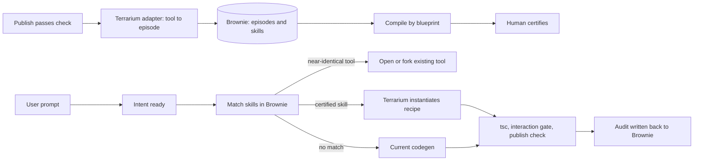

# Brownie as the skill layer for Terrarium

Status: design proposal. No code is changed by this document.

Written from a read of both codebases. Brownie was not run. Every claim about Brownie comes from its source and its own `BROWNIE_FULL_REPORT.md`. Every claim about Terrarium comes from this repo.

## 1. Goal

When a user asks Terrarium to build something, first look for a similar app that was already built, checked and published. If one exists, reuse its proven structure instead of asking the model to write all the code again. If none exists, run codegen as today.

Reuse has to be cheaper, faster or more reliable than codegen, and it has to pass the same checks. A reuse path that skips verification is not allowed.

## 2. Which Brownie

Three copies exist on this machine.

| Path | State | Used here |
|---|---|---|
| `Downloads\Brain Os` | Current. 12 migrations, FastAPI, Next.js review console, MCP server. Working tree has uncommitted changes against its git HEAD. | Yes |
| `Downloads\Terrarium\Brownie\Brownie2.0` | Clone of `github.com/browniehq/Brownie2.0`. 3 migrations, no UI, no workflows, no domains. | No |
| `Desktop\brownie-ai` | A different project (a personal agent with LangGraph and ChromaDB). | No |

## 3. What Brownie is today

Brownie is a self-hosted pipeline.

1. A source adapter turns history into `RawRecord`s. Today that is git commits, optional GitHub PR comments and Slack export zips.
2. Records become episodes: normalized evidence with a 384-dimension local embedding (`all-MiniLM-L6-v2`) stored in Postgres with pgvector.
3. Compile clusters episodes by `(domain, source type, source label, module key)`. It then confirms each cluster with embedding distance (threshold 0.9, minimum support 3).
4. Each cluster becomes a draft skill contract: name, trigger sentence, required steps, contraindications, evidence episode IDs, confidence, verification gate.
5. A human certifies or rejects each draft. Only certified skills can execute.
6. Execution validates arguments, applies a risk tier, may block on an approval, runs typed steps and writes an append-only audit row.

Facts that decide the integration:

- The registered steps are `inspect_relevant_files`, `summarize_expected_change` and `run_verification_gate`. The gate passes when the listed files exist. Executing a skill does not change code.
- Skills store no code or file contents. They hold a trigger sentence, evidence links and step names.
- Matching embeds the task, finds similar episodes in the same domain, then scores certified skills by overlap with their evidence plus token overlap with the skill text. A skill with evidence but no overlap in the top 40 similar episodes is dropped.
- Authentication is for humans: a session cookie plus a CSRF token. There is no service credential. Roles (owner, reviewer, developer) are global, not per project.
- Domains partition data. Two exist: `engineering` and `customer_support`. A domain defines allowed source types, tier rules and gate examples.
- Evidence visibility (`public`, `role`, `user`) is checked before compile, match and inspect.
- The eval report is synthetic. There is no measured proof yet that skills improve an agent.

## 4. What Terrarium already has

- **Blueprint generation.** `contract_v2.py` defines `AppSpec` (slug, title, entity, fields, features, status field, statuses, extra pages, pack). `build_contract` and `deterministic_files` produce types, seed data, hooks, tokens, CSS and the app shell without a model. The model writes only leaf and page files.
- **Deterministic edits.** `apply_blueprint_edit` supports add-field, rename, new-filter, new-page and change-label without a model call.
- **Catalogue.** `SPECS` (10 apps) and `DOMAINS` (about 40 nouns) plus pack scaffolds for landing, charts and the multi-step form.
- **Publish and store.** `POST /sessions/{id}/publish` in `apps/api/terrarium_api/routes/workspace.py` runs `run_publish_check` (`trust/gate.py`) and writes the file set to `tool_versions.files`. Health is stored in `tool_health`.
- **Visibility.** Tools are `all`, `group` or private. `can_see_tool` and `tool_members` enforce it.
- **Open from a match.** `POST /sessions/{id}/accept-match` loads a published tool into a session and routes the next prompt to the editor.
- **Unused reuse slot.** `tool_index` stores a SHA-256 of the normalized prompt plus stack (`packages/agents/terrarium_agents/smart_match.py`). It is exact match only. The `smartmatch.hit` and `smartmatch.miss` events exist in the contracts and `SmartMatchOffer.tsx` renders them, but nothing in the API or worker emits them.
- **Outcome data.** Codegen metrics record spend, stage times, repairs and validation. Publish health records tests, regression, dependencies, secrets and attacks. Acceptance checks and heal attempts are stored per session.

## 5. Why a direct integration fails

1. **Path-based clustering collapses.** Generated apps share the scaffold paths (`src/views/ListPage.tsx`, `src/hooks/useData.ts`, and so on). Brownie's file/module bucketing would put them in one cluster. Clustering must key on the blueprint.
2. **No code artifact.** Brownie's executor cannot return a file map, and the sandbox, `tsc` and trust gate are in Terrarium. File-producing steps must run in Terrarium.
3. **Privacy.** A skill compiled from a private tool would give that tool's structure to other users. Brownie has no per-project access control.
4. **Infrastructure and auth.** Brownie needs pgvector and a sentence-transformers model. Terrarium's database is `postgres:16-alpine`. Brownie's API has no way for Terrarium's worker to authenticate.

## 6. Decision

Run Brownie as a separate service next to Terrarium. Brownie owns selection, certification, provenance and audit. Terrarium owns instantiation and verification.

| Option | Verdict | Reason |
|---|---|---|
| Import Brownie as a Python library | No | Pulls in a sync store, pgvector and a torch-based embedder. Couples releases. |
| MCP tools inside the pipeline | No | The codegen pipeline is not an MCP agent. MCP stays useful for developers in Cursor. |
| Separate service called by the worker | Yes | Clean boundary. Own database. Brownie keeps its review console and audit. |

## 7. The skill

A skill in this integration is a recipe, not a checklist.

| Field | Meaning |
|---|---|
| `trigger_condition` | Plain sentence describing the kind of request, as Brownie already requires. |
| `blueprint` | The `AppSpec` as JSON: archetype, pack, entity, fields, features, status field, statuses, extra pages. |
| `slots` | Which parts of the blueprint a new request may change: title, entity name, fields, statuses, theme, extra pages. |
| `certified_files` | For each leaf component, the file text from a source version, plus its prop contract (name, props, cardinality). |
| `gates` | Static check, `tsc`, interaction gate, publish check. Always all of them. |
| `sources` | The tool IDs and version IDs the skill came from. |
| `required_steps` | Names from a Terrarium-side typed registry (below). Unknown names fail closed. |

Typed step registry, held in Terrarium:

- `instantiate_blueprint`: build the scaffold from the blueprint with slot values.
- `reuse_certified_leaf`: copy a certified leaf when the prop contract matches exactly.
- `adapt_leaf`: ask the model to adapt one certified leaf to a changed contract, with the certified file as the starting text.
- `apply_blueprint_edit`: reuse the existing deterministic edit.
- `run_gates`: static, `tsc`, interaction gate, publish check.

Brownie stores and governs the skill. Terrarium runs the steps and posts the result back.

## 8. Request-time ladder

The worker calls Brownie once, after intent returns `ready` and before the plan step. The call sends the prompt, the intent summary, the user's ID and the user's visible-tool scope.

| Result | Terrarium does | Model use |
|---|---|---|
| Near-identical tool the user can already see | Emit `smartmatch.hit`. The UI offers open or fork through `accept-match`. | None |
| Certified skill above the high threshold | Resolve slot values (reuse the existing blueprint call). `instantiate_blueprint`. `reuse_certified_leaf` where props match. `adapt_leaf` for the rest. | Small |
| Match between the low and high thresholds | No code reuse. Add the matched certified files to the per-file prompt as reference. | Normal |
| No match | Current pipeline. Emit `smartmatch.miss`. | Normal |

Every path ends in the same gates. A skill match never lets an app reach `preview.ready` without them. The demo-mode and kill-switch rules apply to every path.

Thresholds are set from measured data in phase 1, not guessed here.

## 9. Learning loop

1. A version is published and passes the check.
2. A Terrarium adapter writes one episode per published version: prompt, intent summary, blueprint, file hashes, version ID, tool ID. The outcome field carries the health status, acceptance results, heal attempts and whether the owner edited after publish.
3. Compile clusters episodes by blueprint: archetype, pack, entity shape (field names and types), features. Embeddings come from prompt plus blueprint text.
4. A cluster with enough independent tools becomes a draft skill. A reviewer certifies it in Brownie's console or from a button in the Terrarium dashboard.
5. The nightly trust scan (`trust/campaigns.py`) reads live versions. If it finds an advisory in a source version, Terrarium tells Brownie to supersede the skill. A remediated version becomes a new skill version.

## 10. Privacy rule

Only tools with `visibility = all` that are live and have health `safe` may become episodes. Group and private tools are not ingested. Seed data in `certified_files` is replaced by blueprint sample values before storage. The owner can withdraw a tool, which removes its episodes and supersedes any skill that depended on fewer than the minimum number of sources.

Group-scoped skills are out of scope for this version.

## 11. New interfaces

Brownie side:

- A service credential for Terrarium's worker, separate from human sessions.
- `POST /skills/match` accepting a service call, returning skill, score, reasons, matched sources.
- `POST /episodes/batch` for the adapter.
- `POST /audit/external` to record a run Terrarium executed.
- `POST /skills/{id}/supersede` for the trust scan.
- A new domain `app_building` with allowed source type `terrarium_tool`, tier rules and gate examples.
- Blueprint-based clustering for that domain.

Terrarium side:

- Source adapter and the episode writer, called after a successful publish.
- Match client in the worker. Failure to reach Brownie falls through to current codegen. Brownie is never on the critical path.
- The typed step registry from section 7.
- Emission of `smartmatch.hit` and `smartmatch.miss`.
- A certify action in the dashboard for reviewers.

## 12. Phases

| Phase | Work | Exit criterion |
|---|---|---|
| 1. Measure | Adapter and `app_building` domain. Ingest existing published `all`-visibility tools offline. Replay recent prompts against the index. | Report of how many prompts would have matched at each score, and how often the match was truly similar on manual review. Stop here if the rate is too low to matter. |
| 2. Skill format | Recipe skill, blueprint clustering, seed skills from `SPECS` and `DOMAINS`, certify action. | At least the catalogue skills certified and visible. |
| 3. Live match | Service credential, match client, ladder tiers 0 and 1, events. | A/B on the same prompts against current codegen: cost, time to first preview, repairs per app, validated rate. Skill path is no worse on validated rate and better on at least cost or time. |
| 4. Leaf reuse and audit | `reuse_certified_leaf`, `adapt_leaf`, audit write-back, supersede on advisory. | Reuse rate and repair rate measured. No gate skipped. |

The A/B method follows Brownie's own README: run the same tasks with and without the skill layer and compare.

## 13. Metrics

Already measured by `docs/codegen-metrics`: spend per app, stage seconds, repairs, `staticOk`, validated. Add: match rate, tier mix, certified-leaf reuse count, and skill-instantiated app pass rate against codegen pass rate.

## 14. Risks

- **Sameness.** Reuse can make apps look alike. The variety gate (`visual_signature`) still applies to instantiated apps.
- **Few sources.** With few published tools the matcher will rarely return a skill. Seeding from the catalogue covers the start.
- **Brownie maturity.** It is a prototype, its eval is synthetic, and its sync store is large. Phase 1 is meant to find out cheaply whether to continue.
- **Stale skills.** A skill can outlive a scaffold change. Store `SCAFFOLD_VERSION` on each skill and supersede on mismatch.
- **Latency.** The embedding model must stay loaded in the Brownie service. Match must return in well under the intent step's 2 to 3 seconds, or the worker skips it.
- **Drift between copies.** Brownie work should happen in one repo. Brain Os has uncommitted changes that the cloned Brownie2.0 does not.

## 15. Not in scope

- Group-scoped skills.
- Brownie's Slack and GitHub PR sources.
- Replacing Terrarium's per-file generator.
- Autonomous certification.
- Changing codegen thresholds or the 16,000 output cap.

## 16. Open questions

- Who certifies: workspace owner, a reviewer role, or both?
- Should the match run for every prompt or only for allowlisted accounts first, as demo mode does today?
- Where does the Brownie service run in staging, and who owns its database backups?
- Which copy of Brownie is the source of truth going forward?
